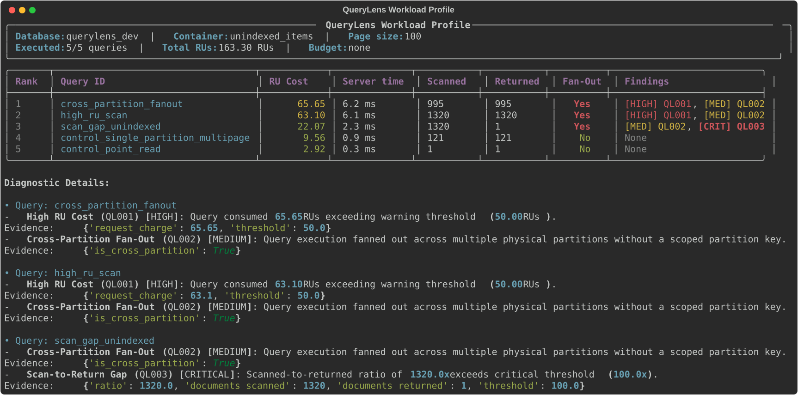

# QueryLens 🔍

[](https://github.com/mwalczyk81/querylens/actions/workflows/ci.yml)
[](https://codecov.io/gh/mwalczyk81/querylens)
[](https://securityscorecards.dev/viewer/?repo=github.com/mwalczyk81/querylens)
[](https://opensource.org/licenses/MIT)
[](https://www.python.org/downloads/)



*Sample terminal report generated by QueryLens. The profile ranks queries descending by Request Units (**RU Cost**), displaying total server-side execution time (**Server time**), physical documents scanned versus retrieved (**Scanned** and **Returned**), cross-partition execution status (**Fan-Out**), and fired diagnostic anti-pattern findings (**Findings**).*

QueryLens is a fast, developer-friendly command-line profiler for **Azure Cosmos DB for NoSQL** query workloads. It captures Request Units (RUs), execution latencies, physical partition fan-out, and document scan-to-return ratios, ranks queries by cost, and flags anti-patterns with quantitative metric evidence.

A **Request Unit (RU)** is Azure Cosmos DB's normalized unit of cost and throughput, representing the compute, memory, and IOPS consumed to execute a database operation. **Cross-partition fan-out** occurs when a query omits a scoped partition key, forcing Cosmos DB to query all physical partitions in parallel, multiplying latency and RU consumption as data scales.

---

## ⚙️ How It Works

QueryLens parses workload definitions in YAML, executes queries in read-only streaming mode via the Azure Cosmos DB SDK, captures server response metrics, and runs diagnostic anti-pattern rules. The profiler is designed around a clean `DatabaseAdapter` Protocol seam that decouples query execution from rule analysis and terminal/JSON reporting.

For full architectural diagrams, extension seams, and deterministic exit-code decision flows, see [Architecture & Design](docs/ARCHITECTURE.md).

---

## ✨ Features

- **Ranked Workload Profiling**: Executes a YAML workload of queries and ranks them descending by Request Units (RUs).
- **Automated Anti-Pattern Diagnostics**:
  - `QL001: High RU Cost` — Flags queries exceeding warning (50 RUs) or critical (200 RUs) thresholds.
  - `QL002: Cross-Partition Fan-Out` — Identifies un-partitioned queries fanning out across physical partitions.
  - `QL003: Scan-to-Return Gap` — Diagnoses queries scanning significantly more documents than returned (10x warning, 100x critical, or 1000+ scanned with 0 returned).
- **Read-Only & Payload Privacy**:
  - **Read-Only**: Strictly enforces read-only query execution with passwordless Entra ID (`DefaultAzureCredential`).
  - **Zero Payload Persistence**: Result document payloads are immediately consumed and discarded during streaming iteration; document contents are never logged, cached, or written to disk.
  - **Per-Page Budget Guard**: Halts execution mid-query if cumulative RUs exceed `--ru-budget` to prevent billing surprises (the guard checks per page and can overshoot by up to one page).
- **CI/CD Quality Gate**:
  - `--fail-on <severity>` exits with code `4` if performance regressions or anti-patterns exceed `critical`, `high`, or `medium` thresholds.
  - Strict machine-readable `--json` output conforming to JSON Schema.

---

## 🚀 Quickstart

Get started locally with QueryLens in a few minutes using Docker Compose and the local Cosmos DB emulator:

### Prerequisites

- [Docker](https://docs.docker.com/get-docker/) (with Docker Compose)
- [uv](https://docs.astral.sh/uv/) (recommended) or [Python 3.12+](https://www.python.org/downloads/)
- [Git](https://git-scm.com/)

### 1. Clone & Synchronize Dependencies

```bash
git clone https://github.com/mwalczyk81/querylens.git
cd querylens
uv sync
```

### 2. Start Local Cosmos DB Emulator

```bash
docker compose up -d
```

### 3. Seed Emulator with Deterministic Test Data

```bash
uv run python scripts/seed_emulator.py
```

The script initializes the `querylens_dev` database with two containers: `items` (default indexing) and `unindexed_items` (where `/unindexed_tag/?` is excluded from the indexing policy), deterministically populating 1,320 documents across 60 partition keys (including small items, 20 large multi-KB documents, and a dense 121-document partition) to trigger fan-out and scan-gap metrics.

### 4. Run QueryLens Against Example Workload

Workload files define target containers and queries to profile (see [`examples/workload.yaml`](examples/workload.yaml)):

```yaml
version: "1"
database: "querylens_dev"
container: "unindexed_items"

queries:
  # Expected: QL001 (High RU Cost) and QL002 (Cross-Partition Fan-Out)
  - id: "high_ru_scan"
    query: "SELECT * FROM c"

  # Expected: QL002 (Cross-Partition Fan-Out)
  - id: "cross_partition_fanout"
    query: "SELECT * FROM c WHERE c.status = 'active'"
```

Configure the emulator endpoint and master key, then profile the workload:

```bash
# On Linux / macOS / Bash:
export QUERYLENS_ENDPOINT="https://localhost:8081/"
export QUERYLENS_COSMOS_KEY="C2y6yDjf5/R+ob0N8A7Cgv30VRDJIWEHLM+4QDU5DE2nQ9nDuVTqobD4b8mGGyPMbIZnqyMsEcaGQy67XIw/Jw=="
uv run querylens run examples/workload.yaml

# On Windows PowerShell:
$env:QUERYLENS_ENDPOINT = "https://localhost:8081/"
$env:QUERYLENS_COSMOS_KEY = "C2y6yDjf5/R+ob0N8A7Cgv30VRDJIWEHLM+4QDU5DE2nQ9nDuVTqobD4b8mGGyPMbIZnqyMsEcaGQy67XIw/Jw=="
uv run querylens run examples/workload.yaml
```

> [!NOTE]
> **Emulator Key & TLS Verification**: The key shown above is Microsoft's public well-known Cosmos DB emulator key, not a secret. TLS verification is disabled for the local emulator only (the CLI prints a one-line notice: `TLS verification disabled for local emulator`). Remote Azure endpoints enforce strict TLS validation and authenticate via passwordless Entra ID (`DefaultAzureCredential`).
>
> **Page Size and RU Accounting**: Reported Request Units include Azure Cosmos DB's minimum per-request charge (approximately 2.9 RU per HTTP gateway request page). Consequently, cumulative RU consumption increases as `--max-item-count` shrinks because retrieving the same dataset requires more round-trip pages. Always compare workload profiling runs using identical page sizes (`--max-item-count`).
>
> **Partial Results Semantics**: When cumulative Request Units exceed `--ru-budget`, execution terminates immediately:
>
> - **RU Cost**: Displays cumulative RUs consumed prior to abortion, annotated with `(partial)`. This represents a valid lower bound on total query cost.
> - **Fan-Out**: Displays `unknown` in terminal reports and emits `null` for `is_cross_partition` in `--json` output when no `partition_key` was specified (since incomplete execution cannot determine whether unvisited partitions would have been contacted), or `No` (`false`) if the query had a targeted `partition_key`.
> - **Diagnostic Rules**: Structural and ratio rules `QL002` (Fan-Out) and `QL003` (Scan-to-Return Gap) are skipped on partial costs because partial execution cannot reliably assess full-workload partition coverage or scan-to-return ratios. `QL001` (High RU Cost) remains active because partial charge is a valid lower bound.
> - **Findings**: Displays `n/a (partial)` if no findings (such as `QL001`) fired on the partial row.

---

## 🔍 Discover Query Costs from Diagnostic Logs (`querylens discover`)

For production environments with hundreds of services or dynamically generated LINQ queries, manually authoring workload files is impractical. The `querylens discover` command aggregates existing Azure Log Analytics diagnostic logs to uncover the most expensive query shapes and attributing callers across your Cosmos DB databases.

### Prerequisites & Permissions

- **Authentication**: Authenticates passwordlessly via Microsoft Entra ID (`DefaultAzureCredential`). Run `az login` prior to execution.
- **RBAC Role**: Requires the built-in **Log Analytics Reader** role on the target workspace. No Cosmos DB credentials or data-plane access are required.
- **Diagnostic Settings**: Requires Azure Cosmos DB diagnostic settings routed to Log Analytics using the legacy **AzureDiagnostics** table (`ResourceProvider =~ "MICROSOFT.DOCUMENTDB"`), with both `DataPlaneRequests` and `QueryRuntimeStatistics` categories enabled.

### Basic Discovery

Discover the top 20 query shapes over the last 24 hours:

```bash
uv run querylens discover --workspace-id <LOG_ANALYTICS_WORKSPACE_ID>
```

Filter by specific Cosmos DB account or adjust the evaluation window:

```bash
uv run querylens discover -w <WORKSPACE_ID> --account my-prod-cosmos -t 7d --top 10
```

> [!NOTE]
> **Log Ingestion Latency**: Azure Log Analytics diagnostic logs typically exhibit an ingestion latency of 2 to 5 minutes between Cosmos DB event generation and availability in diagnostic tables. The most recent few minutes of telemetry in the evaluation window may still be processing and therefore incomplete.

### Preflight Workspace Check (`--check`)

Before running discovery, verify whether the Log Analytics workspace has complete diagnostic telemetry configured:

```bash
uv run querylens discover -w <WORKSPACE_ID> --check
```

The preflight report checks category presence, record timestamps, column coverage ratios, and authentication token distributions. It outputs **0% customer data or query text**, making it safe to share internally when troubleshooting telemetry issues.

### Offline KQL Inspection (`--print-kql`)

To inspect or copy the server-side KQL queries directly into the Azure Portal Logs editor:

```bash
uv run querylens discover -w <WORKSPACE_ID> --print-kql
```

`--print-kql` validates input options, builds both generated queries (`Query 1: Top Shapes` and `Query 2: Totals`), and prints them to stdout with **zero network calls and zero Azure credentials**. Combining `--check` with `--print-kql` prints the preflight diagnostic query.

### Sensitive Query Text Privacy (`--show-text`)

To protect potentially sensitive query filters from leaking into terminal scrollback or automated log aggregators:

- **Terminal Table**: `Sample Query` is truncated to 200 characters by default.
- **Machine-Readable JSON**: `sample_query_text` is **completely omitted** by default.
- **Structured Logs**: Query text is never logged to debug loggers.

To explicitly include full obfuscated query text in console and JSON outputs, pass `--show-text`:

```bash
uv run querylens discover -w <WORKSPACE_ID> --show-text --json
```

> [!NOTE]
> **Microsoft Query-Text Obfuscation Caveat**: In `QueryRuntimeStatistics` diagnostic logs, Microsoft Azure automatically obfuscates query text by replacing filter literals and parameters with placeholders. QueryLens preserves and displays this text verbatim as emitted by Azure.
>
> **Discovered Shapes Cannot Be Replayed**: Because Microsoft obfuscates runtime parameter values and does not log partition key values in diagnostic telemetry, discovered query shapes cannot be automatically converted into replayable workload files for `querylens run`.

---

## 📊 Machine-Readable Output (`--json`)

QueryLens supports CI/CD automation and dashboard integration via the global `--json` flag. The structured output conforms to [`run-output-schema.json`](specs/001-cosmos-query-cost/contracts/run-output-schema.json).

Below is a single-query excerpt from [`docs/assets/sample-run.json`](docs/assets/sample-run.json) showing cost metrics and diagnostic findings matching the terminal profile:

```json
{
  "cost": {
    "query_id": "scan_gap_unindexed",
    "query_text": "SELECT * FROM c WHERE c.unindexed_tag = 'target'",
    "request_charge": 22.07,
    "latency_ms": 2.3,
    "documents_scanned": 1320,
    "documents_returned": 1,
    "is_cross_partition": true,
    "is_partial": false,
    "index_metrics": null,
    "error_message": null,
    "activity_id": null,
    "has_partition_key": false
  },
  "findings": [
    {
      "rule_id": "QL002",
      "rule_name": "Cross-Partition Fan-Out",
      "severity": "MEDIUM",
      "summary": "Query execution fanned out across multiple physical partitions without a scoped partition key.",
      "evidence": {
        "is_cross_partition": true
      }
    },
    {
      "rule_id": "QL003",
      "rule_name": "Scan-to-Return Gap",
      "severity": "CRITICAL",
      "summary": "Scanned-to-returned ratio of 1320.0x exceeds critical threshold (100.0x).",
      "evidence": {
        "ratio": 1320.0,
        "documents_scanned": 1320,
        "documents_returned": 1,
        "threshold": 100.0
      }
    }
  ]
}
```

> [!NOTE]
> **Nullable `is_cross_partition`**: `cost.is_cross_partition` is `bool | null`. When `--ru-budget` halts a query mid-stream without a targeted partition key, `is_cross_partition` emits `null` (corresponding directly to `unknown` in the terminal table). For completed queries or partitioned queries, it emits boolean `true` or `false`.

---

## 🚦 Exit Codes Contract

QueryLens enforces deterministic exit codes designed for automated CI/CD pipeline orchestration:

| Exit Code | Classification | Trigger Condition |
| :---: | :--- | :--- |
| **`0`** | **Success** | All queries executed successfully without budget exhaustion, and all findings are below `--fail-on` threshold. |
| **`1`** | **Validation / Usage / Query Error** | CLI usage errors (unknown option, missing argument), invalid YAML, invalid partition key format, or one or more queries failed execution (e.g. HTTP 400 syntax error). |
| **`2`** | **Budget Exceeded** | Cumulative Request Units exceeded `--ru-budget`. Execution aborted mid-query; partial results returned. |
| **`3`** | **Connection Error** | Network unreachable, DNS resolution error, or target database/container not found (HTTP 404). |
| **`4`** | **Diagnostic Gate Breached** | At least one diagnostic finding met or exceeded `--fail-on <severity>`. |
| **`5`** | **Authentication / Authorization Failure** | Invalid credentials, expired token, missing `Cosmos DB Built-in Data Reader` role, or HTTP 401/403. |

### Exit Code Precedence

When multiple conditions occur during a workload run, exit codes resolve by strict precedence:

1. **`2` (Budget Exceeded)** — Safety circuit-breaker halts execution; results are partial.
2. **`4` (Diagnostic Gate Breached)** — Quality gate failure evaluated across completed queries.
3. **`1` (Query Error / Validation)** — Query syntax failure or invalid configuration.
4. **`0` (Success)** — Clean execution with no gates breached.
*(Connection `3` and authentication `5` errors terminate immediately when encountered).*

---

## 🛡️ Security & Privacy

QueryLens is built with security-first invariants:

1. **Entra ID Passwordless Authentication**: Prioritizes `DefaultAzureCredential`. Master key authentication is strictly restricted to the local Cosmos DB emulator (`localhost` / `127.0.0.1`).
2. **Least Privilege**: Only requires the Azure Cosmos DB built-in role `Cosmos DB Built-in Data Reader`.
3. **Payload Discard**: Iterates over query results using `for _ in page: pass`, dropping item bodies immediately. QueryLens extracts only metadata headers (`x-ms-request-charge`, `x-ms-documentdb-query-metrics`, `x-ms-cosmos-index-utilization`).

---

## 🔍 Quality at a Glance

QueryLens is tested and verified across three levels:

- **Unit tests**: Deterministic verification of metrics parsers, domain models, CLI options, KQL query builders, and report formatters.
- **Property-based tests**: Generative testing with Hypothesis verifying invariant boundaries and monotonic behavior across randomized input spaces.
- **Integration tests**: End-to-end execution against a real Azure Cosmos DB Linux emulator in containerized CI environments.

Every change triggers automated CI workflows enforcing strict code hygiene (Ruff formatting and linting), strict type checking (Pyrefly), security audits (`pip-audit`, Gitleaks secret detection, CodeQL static analysis), and an automated test coverage gate. Track live workflow runs on [GitHub Actions](https://github.com/mwalczyk81/querylens/actions) and test coverage on [Codecov](https://codecov.io/gh/mwalczyk81/querylens).

### Security Posture

We track repository supply chain security using the [OpenSSF Scorecard](https://securityscorecards.dev/viewer/?repo=github.com/mwalczyk81/querylens). Scorecard evaluates open-source projects against automated security criteria:

- **Strong automated controls**: GitHub Actions pinned to immutable commit SHAs with version comments, minimal `GITHUB_TOKEN` permissions (`contents: read`), CodeQL static analysis (SAST), automated dependency updates via Dependabot, dependency vulnerability scanning with `pip-audit`, secret scanning via Gitleaks, and a published security policy ([SECURITY.md](SECURITY.md)).
- **Structural characteristics of a young solo project**: Some Scorecard checks are structurally low for early-stage single-maintainer repositories rather than reflecting security gaps. Specifically, **Code-Review** requires pull requests to be approved by a second reviewer, **Contributors** requires maintainers from multiple distinct organizations, and **Maintained** requires commit activity spanning at least 90 days.

---

## 🧪 Local Development & Testing

```bash
# Clone the repository
git clone https://github.com/mwalczyk81/querylens.git
cd querylens

# Synchronize virtual environment with uv
uv sync

# Run full test suite with coverage gate (>= 85%)
uv run pytest --cov=querylens --cov-fail-under=85

# Run property tests with Hypothesis
uv run pytest tests/unit/test_rules_property.py

# Run linters and strict type checks
uv run ruff check .
uv run ruff format --check .
uv run pyrefly check
```

### Running with Docker Cosmos DB Emulator

```bash
# Start emulator
docker compose up -d cosmos-emulator

# Run integration tests against emulator
uv run pytest -m integration
```

---

## 📄 License

MIT © [Matt Walczyk](https://github.com/mwalczyk81)
