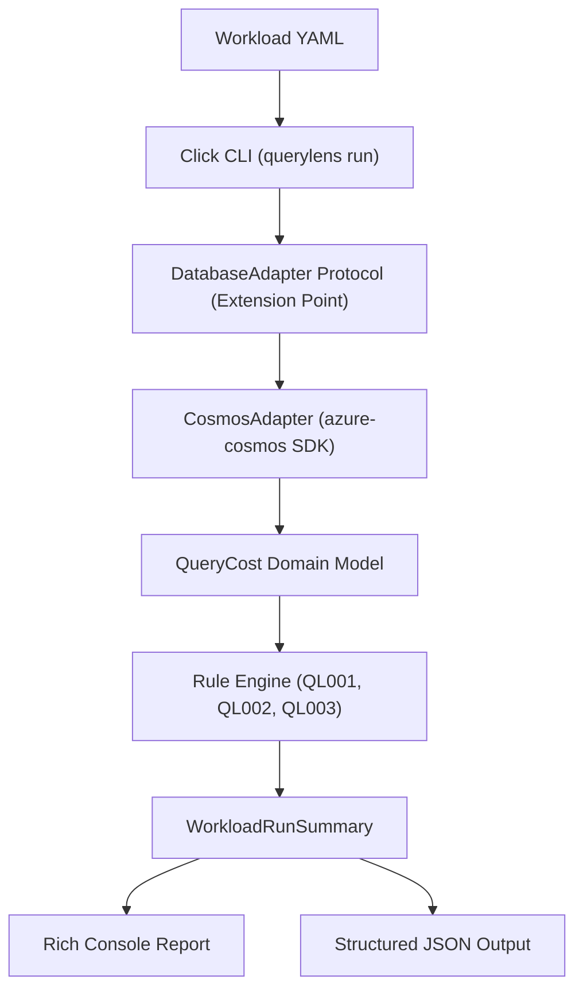
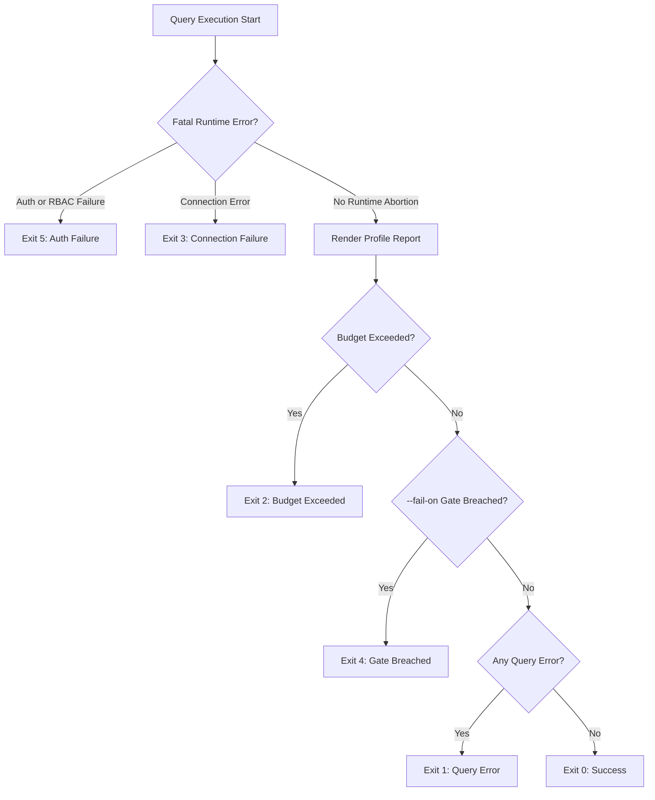

# Architecture & Design

This document outlines the architecture, data flow, extension points, and exit-code semantics of QueryLens.

---

## Component Architecture & Data Flow

QueryLens follows a layered design centered around the `DatabaseAdapter` Protocol seam, decoupling query execution from anti-pattern diagnostics and reporting:



### Protocol Seam as Extension Point

The profiler engine communicates with database engines exclusively through `DatabaseAdapter` (`src/querylens/adapters/protocol.py`), defined as a Python `typing.Protocol`:

```python
class DatabaseAdapter(Protocol):
    def collect(self, workload: Workload) -> Iterator[QueryCost]: ...
```

`CosmosAdapter` implements this protocol for Azure Cosmos DB for NoSQL. Additional database adapters (such as MongoDB vCore, PostgreSQL, or Couchbase) can be plugged in by providing a new adapter conforming to `DatabaseAdapter` without altering the diagnostic rules, budget guards, or reporting layers.

---

## Exit-Code Decision Hierarchy

QueryLens enforces a deterministic exit-code precedence hierarchy for reliable orchestration in CI/CD pipelines. Fatal environment and authentication failures abort immediately, while completed runs render their full reports before evaluating exit criteria:



### Exit Codes Reference

| Exit Code | Reason | Timing |
| --------- | ------ | ------ |
| **0** | Success: All queries executed cleanly and no diagnostic gates were breached. | After report |
| **1** | Query or Validation Error: Malformed YAML, invalid CLI parameters, or query syntax errors. | After report |
| **2** | Budget Exceeded: Cumulative Request Units exceeded `--ru-budget` ceiling. | After report |
| **3** | Connection Failure: Target endpoint unreachable or network dropped mid-run. | Immediate abort |
| **4** | Diagnostic Gate Breached: Findings met or exceeded `--fail-on` threshold. | After report |
| **5** | Authentication Failure: Missing credentials or permission denied. | Immediate abort |

---

## Design Decisions

Key architectural choices are formally documented in our Architectural Decision Records:

- [ADR 0001](adr/0001-minimal-databaseadapter-protocol.md): Minimal `DatabaseAdapter` Protocol (`collect(workload) -> Iterator[QueryCost]`) and unified domain model, keeping diagnostic rules pure and decoupled from SDK specifics.
- [ADR 0002](adr/0002-read-only-safety-and-payload-privacy.md): Read-only safety guarantees, immediate streaming payload discard (`for _ in page: pass`) with zero disk or cache persistence, and per-page RU budget circuit breakers.
- [ADR 0003](adr/0003-test-first-property-testing-and-docker-emulator.md): TDD testing strategy combining Hypothesis property-based fuzzing, Syrupy snapshot assertions, and automated Docker Linux Cosmos DB emulator integration.
- [ADR 0004](adr/0004-cli-first-design-and-deterministic-exit-codes.md): CLI-first ergonomics and strict deterministic exit code hierarchy (`0`, `1`, `2`, `3`, `4`, `5`) for pipeline orchestration.
- [ADR 0005](adr/0005-azure-cosmos-sdk-contracts-and-metrics-extraction.md): Azure Cosmos SDK metrics extraction via `response_hook`, header parsing, and distinct physical partition key range IDs for cross-partition detection.
