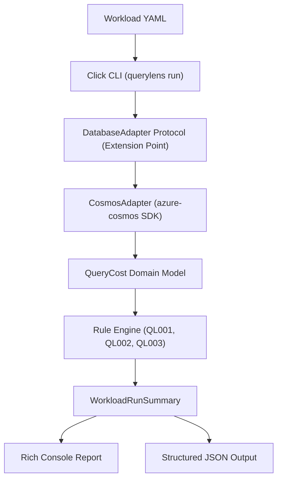
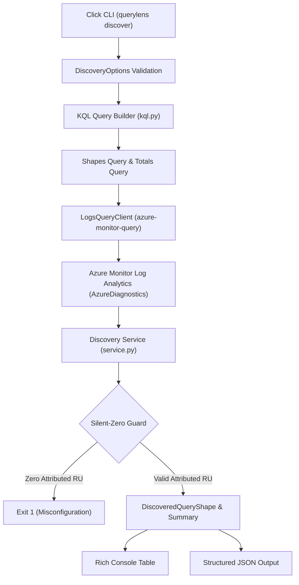
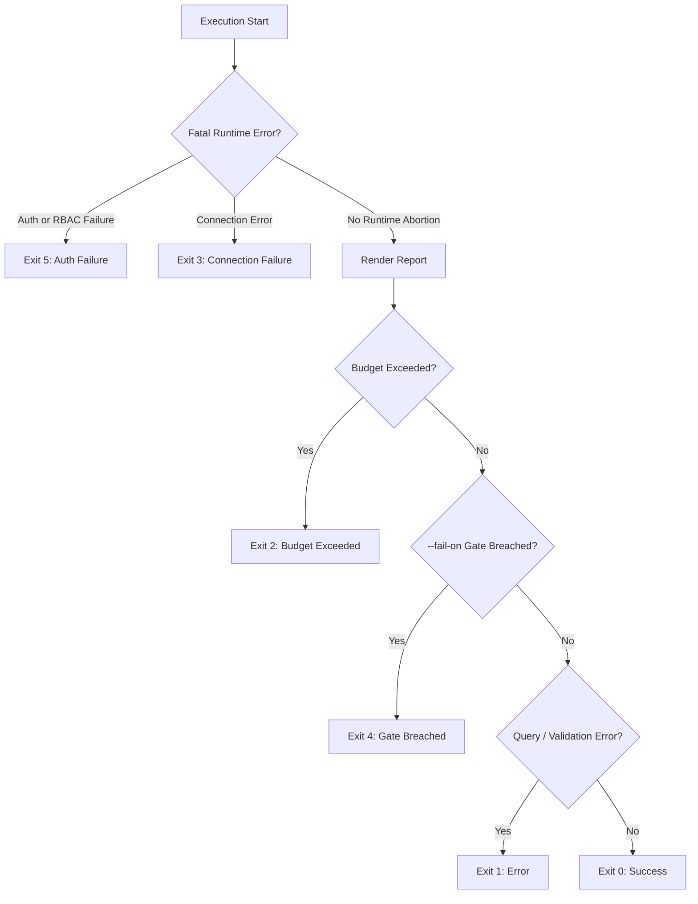

# Architecture & Design

This document outlines the architecture, data flow, extension points, and exit-code semantics of QueryLens.

---

## Component Architecture & Data Flow

QueryLens follows a layered design centered around the `DatabaseAdapter` Protocol seam, decoupling query execution from anti-pattern diagnostics and reporting:



### Protocol Seam as Extension Point

The profiler engine communicates with database engines exclusively through `DatabaseAdapter` (`src/querylens/adapters/protocol.py`), defined as a Python `typing.Protocol`:

```python
class DatabaseAdapter(Protocol):
    def collect(self, workload: Workload) -> Iterator[QueryCost]: ...
```

`CosmosAdapter` implements this protocol for Azure Cosmos DB for NoSQL. Additional database adapters (such as MongoDB vCore, PostgreSQL, or Couchbase) can be plugged in by providing a new adapter conforming to `DatabaseAdapter` without altering the diagnostic rules, budget guards, or reporting layers.

---

## Log Analytics Discovery Architecture (`querylens discover`)

The discovery engine queries Azure Monitor Log Analytics to uncover top query shapes directly from historical diagnostic logs:



Unlike `querylens run`, `querylens discover` queries Azure Monitor management telemetry using the official `azure-monitor-query` SDK and `DefaultAzureCredential` (requiring `Log Analytics Reader`). It executes server-side KQL aggregation without reading from the Cosmos DB data plane, bypassing the `DatabaseAdapter` protocol seam entirely.

---

## Exit-Code Decision Hierarchy

QueryLens uses an exit-code precedence hierarchy for CI/CD pipelines. Fatal environment and authentication failures abort immediately, while completed runs render their full reports before evaluating exit criteria:



### Exit Codes Reference

| Exit Code | Reason | Timing |
| --------- | ------ | ------ |
| **0** | Success: Workload profile succeeded cleanly, or discovery completed with valid shapes or clean empty window. | After report |
| **1** | Query or Validation Error: Malformed YAML, invalid CLI options, query syntax errors, or discovery Silent-Zero Guard misconfiguration. | After report / Immediate |
| **2** | Budget Exceeded: Cumulative Request Units exceeded `--ru-budget` ceiling (profiling mode only). | After report |
| **3** | Connection Failure: Target endpoint unreachable, network dropped mid-run, or Log Analytics workspace unreachable. | Immediate abort |
| **4** | Diagnostic Gate Breached: Findings met or exceeded `--fail-on` threshold (profiling mode only). | After report |
| **5** | Authentication Failure: Missing credentials, expired token, or missing RBAC permissions (`Cosmos DB Built-in Data Reader` or `Log Analytics Reader`). | Immediate abort |

---

## Design Decisions

Architectural choices are documented in our Architectural Decision Records:

- [ADR 0001](adr/0001-minimal-databaseadapter-protocol.md): `DatabaseAdapter` Protocol (`collect(workload) -> Iterator[QueryCost]`) and unified domain model, keeping diagnostic rules decoupled from SDK specifics.
- [ADR 0002](adr/0002-read-only-safety-and-payload-privacy.md): Read-only queries, streaming payload discard (`for _ in page: pass`) with no disk or cache persistence, and per-page RU budget circuit breakers.
- [ADR 0003](adr/0003-test-first-property-testing-and-docker-emulator.md): Testing strategy combining Hypothesis property-based tests, Syrupy snapshot assertions, and Docker Linux Cosmos DB emulator integration.
- [ADR 0004](adr/0004-cli-first-design-and-deterministic-exit-codes.md): CLI ergonomics and exit code hierarchy (`0`, `1`, `2`, `3`, `4`, `5`) for pipeline orchestration.
- [ADR 0005](adr/0005-azure-cosmos-sdk-contracts-and-metrics-extraction.md): Azure Cosmos SDK metrics extraction via `response_hook`, header parsing, and distinct physical partition key range IDs for cross-partition detection.
- [ADR 0006](adr/0006-azure-monitor-logs-query-contracts.md): Azure Monitor Logs query contracts, two-query server-side KQL aggregation, container-scoped database resolution, top-3 caller ranking, property bag packaging, and dynamic deserialization.
- [ADR 0007](adr/0007-kql-injection-defense-and-input-validation.md): KQL injection defense, parameter validation, and sanitization invariants for offline and online query construction.
