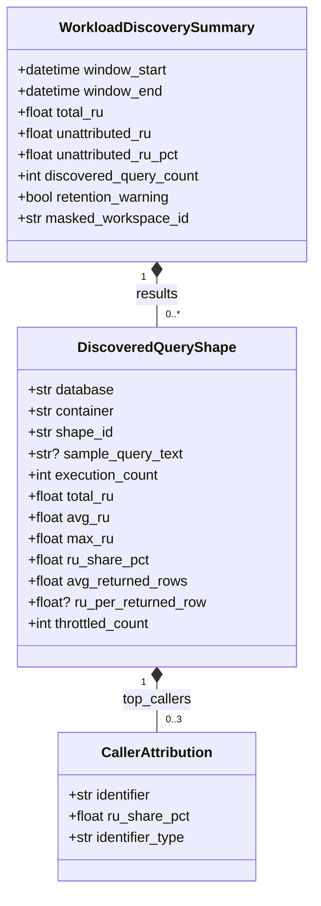

# Data Model: Cosmos DB Query Cost Discovery

**Feature**: `002-query-cost-discovery`  
**Date**: 2026-10-10  
**Status**: Completed  

---

## 1. Domain Entities & Pydantic Schemas

### 1.1 `CallerAttribution`

Represents an individual caller (identity principal or network IP) attributed to query shape execution.

| Field | Type | Description | Validation Rules |
|---|---|---|---|
| `identifier` | `str` | Anonymized or masked caller identifier (Entra ID principal GUID or client IP). | Non-empty string. |
| `ru_share_pct` | `float` | Percentage of this query shape's RU consumed by this caller. | `0.0 <= ru_share_pct <= 100.0` |
| `identifier_type` | `str` | Type of caller identifier. | Must be `"aad_principal"` or `"client_ip"`. |

### 1.2 `DiscoveredQueryShape`

Aggregated performance and cost metrics for a distinct query shape executing on a specific database container.

| Field | Type | Description | Validation Rules |
|---|---|---|---|
| `database` | `str` | Target Cosmos DB database name. | Non-empty string. |
| `container` | `str` | Target Cosmos DB container collection name. | Non-empty string. |
| `shape_id` | `str` | Canonical identifier for query structure (`shapesignature_s` or SHA-256 hash). | Non-empty string, hex/hash format. |
| `sample_query_text` | `str \| None` | Obfuscated query text sample (redacted literals). Omitted from `--json` output unless `--show-text` is passed; truncated to 200 chars in console tables unless `--show-text`. | Optional string (`None` by default in JSON). |
| `execution_count` | `int` | Total number of query executions observed in window. | `>= 1` |
| `total_ru` | `float` | Cumulative Request Units consumed by this query shape. | `>= 0.0` |
| `avg_ru` | `float` | Mean Request Units per query execution. | `>= 0.0` |
| `max_ru` | `float` | Maximum Request Units observed in a single execution. | `>= 0.0` |
| `ru_share_pct` | `float` | Percentage of overall workspace/account RU consumed by this query shape. | `0.0 <= ru_share_pct <= 100.0` |
| `avg_returned_rows` | `float` | Mean document count returned per execution derived from `numberofrowsreturned_s`. | `>= 0.0` |
| `ru_per_returned_row` | `float \| None` | Efficiency ratio: `total_ru / total_returned_rows`. Nullable when returned rows == 0. | Non-negative float or `None`. |
| `throttled_count` | `int` | Count of HTTP 429 (Too Many Requests) events attributed to this shape. | `>= 0` |
| `top_callers` | `list[CallerAttribution]` | Top 3 callers ranked by RU share. | Max 3 items. |

> [!NOTE]
> **Scanned Documents Omission**: A scanned-documents metric is intentionally omitted from the discovery model because Azure Cosmos DB diagnostic logs record only returned rows (`numberofrowsreturned_s`) and do not log scanned documents.

### 1.3 `WorkloadDiscoverySummary`

Top-level summary entity returned by `querylens discover` representing aggregated discovery across the evaluation window.

| Field | Type | Description | Validation Rules |
|---|---|---|---|
| `window_start` | `datetime` | UTC start of the analyzed lookback window. | ISO 8601 UTC. |
| `window_end` | `datetime` | UTC end of the analyzed lookback window. | ISO 8601 UTC, `window_end >= window_start`. |
| `total_ru` | `float` | Total RU across ALL `DataPlaneRequests` in scope and window (the denominator). | `>= 0.0` |
| `attributed_total_ru` | `float` | Cumulative RU summed across ALL joined query shapes in the window (from Totals Query). | `>= 0.0` |
| `unattributed_ru` | `float` | Total RU from non-query operations (`max(0.0, total_ru - attributed_total_ru)`). | `>= 0.0` |
| `unattributed_ru_pct` | `float` | Percentage of total RU that was unattributed (`unattributed_ru / total_ru * 100`). | `0.0 <= unattributed_ru_pct <= 100.0` |
| `discovered_query_count` | `int` | Total number of distinct query shapes returned in `results`. | `>= 0` |
| `results` | `list[DiscoveredQueryShape]` | Ranked list of query shapes sorted descending by `total_ru`. | Length bounded by `--top` (max 100). |
| `retention_warning` | `bool` | True if earliest log record timestamp is newer than requested window start. | Boolean. |
| `masked_workspace_id` | `str` | Target workspace GUID masked showing only the last 4 characters (`"...abcd"`). | Format matching `...[0-9a-fA-F]{4}`. |

> [!WARNING]
> **Silent-Zero Guard Invariant**: If `attributed_total_ru == 0` while `total_ru > 0`, or if essential diagnostic columns (`requestCharge_s`, `activityId_g`, `querytext_s`) are absent/unpopulated in the logs, the model/service raises `TelemetryMisconfigurationError`, aborting execution with CLI exit code 1 and advising the user to run `querylens discover --check`.

### 1.4 `PreflightCheckReport`

Output of `querylens discover --check` verifying diagnostic log readiness. Contains 100% quantitative metrics with zero query text or customer data.

| Field | Type | Description | Validation Rules |
|---|---|---|---|
| `categories_detected` | `list[str]` | Cosmos DB diagnostic categories found (e.g. `["DataPlaneRequests", "QueryRuntimeStatistics"]`). | List of non-empty strings. |
| `row_counts` | `dict[str, int]` | Record count per detected diagnostic category. | All counts `>= 0`. |
| `window_start` | `datetime` | UTC start of evaluated window. | ISO 8601 UTC. |
| `window_end` | `datetime` | UTC end of evaluated window. | ISO 8601 UTC. |
| `earliest_record` | `datetime \| None` | Timestamp of earliest log record observed in workspace. | ISO 8601 UTC or `None`. |
| `latest_record` | `datetime \| None` | Timestamp of latest log record observed in workspace. | ISO 8601 UTC or `None`. |
| `field_coverage` | `dict[str, float]` | Non-null population percentage for key columns (0.0 to 1.0). | Values between `0.0` and `1.0`. |
| `auth_breakdown` | `dict[str, int]` | Frequency count of observed authentication token types. | Non-negative integers. |
| `retention_warning` | `bool` | True if logs do not span the requested lookback window. | Boolean. |
| `masked_workspace_id` | `str` | Masked target workspace GUID (`"...abcd"`). | Format matching `...[0-9a-fA-F]{4}`. |

---

## 2. Configuration & Parameter Validation

### 2.1 `DiscoveryOptions`

Internal configuration object validating CLI arguments and environment variables.

| Field | Source | Validation Rules | Default |
|---|---|---|---|
| `workspace_id` | `--workspace-id` or `QUERYLENS_WORKSPACE_ID` | RFC 4122 UUIDv4 format (`uuid.UUID`). Rejects invalid with exit 1. | *Required* |
| `account_filter` | `--account` | Optional. Regex `^[a-zA-Z0-9][-a-zA-Z0-9]{1,42}[a-zA-Z0-9]$`. Rejects invalid with exit 1. | `None` |
| `time_window` | `--window` | Duration string parsed into `timedelta` (`[1-9][0-9]*[mhd]`). Bounded: `5m` to `90d`. | `timedelta(hours=24)` (`24h`) |
| `top_n` | `--top` | Integer bounded `1 <= top_n <= 100`. Rejects invalid with exit 1. | `20` |
| `server_timeout_seconds` | `--timeout` | Integer bounded `10 <= timeout <= 600`. | `180` |
| `show_text` | `--show-text` | Boolean flag. When True, query text is not truncated to 200 characters. | `False` |
| `check_only` | `--check` | Boolean flag. When True, executes preflight check instead of discovery. | `False` |
| `print_kql` | `--print-kql` | Boolean flag. When True, builds and prints generated KQL to stdout without network calls or credentials. | `False` |
| `json_output` | `--json` | Boolean flag. Output structured JSON to stdout instead of Rich console table. | `False` |

---

## 3. Relationships & Data Flow

